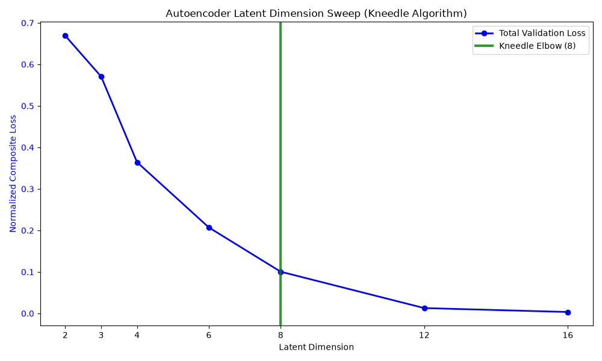
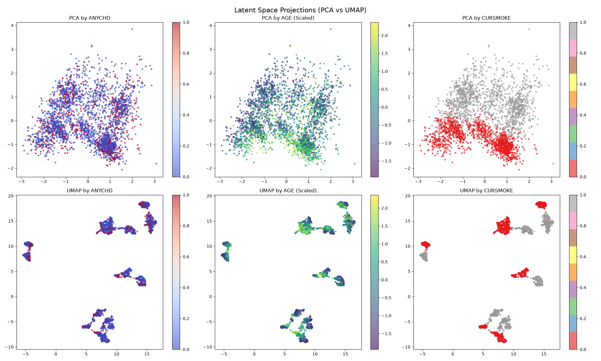

# Phase 3: Autoencoder Latent Space Analysis Summary

This document summarizes the training, dimension selection, and validation of the Split-Head Autoencoder used to learn the physiological manifold of the patient cohort.

## 1. Empirical Latent Dimension Sweep

Rather than picking a latent dimension by convention, we swept latent dimensions `[2, 3, 4, 6, 8, 12, 16]` with `patience=30` to ensure full convergence. 

| Latent Dimension | Total Loss | Cont MSE | Bin Acc | Cat Acc |
|------------------|------------|----------|---------|---------|
| 2                | 0.6691     | 0.5294   | 94.81%  | 99.85%  |
| 3                | 0.5706     | 0.4499   | 94.73%  | 100.0%  |
| 4                | 0.3643     | 0.2740   | 96.61%  | 100.0%  |
| 6                | 0.2071     | 0.1433   | 97.61%  | 100.0%  |
| **8**            | **0.1005** | **0.0467**| **98.36%**| **100.0%**|
| 12               | 0.0128     | 0.0049   | 99.84%  | 100.0%  |
| 16               | 0.0034     | 0.0016   | 99.98%  | 100.0%  |

**Selection**: Using the Kneedle Algorithm on the convex, decreasing loss curve, we rigorously identified the point of maximum curvature at **Dimension 8**.

## 2. Clinical Translation of Reconstruction Error

At Dimension 8, the scaled Continuous MSE is 0.0467. Translated back into native clinical units (using the standard deviations from Phase 1), the average Root Mean Squared Error (RMSE) on the validation set is:

- **AGE**: ±1.45 years
- **TOTCHOL**: ±5.14 mg/dL
- **SYSBP**: ±7.05 mmHg
- **DIABP**: ±4.39 mmHg
- **CIGPDAY**: ±2.26 cigarettes
- **BMI**: ±0.71 kg/m²
- **HEARTRTE**: ±2.22 bpm
- **GLUCOSE**: ±2.32 mg/dL

> [!WARNING] 
> **Important Caveat**: SYSBP shows the largest native-unit reconstruction error (±7.05 mmHg) among continuous features. While still modest relative to its full clinical range (83.5-295 mmHg), clinical hypertension staging often uses 10 mmHg bands. This is acknowledged as a limitation when interpreting fine-grained blood pressure recommendations from the decoded counterfactual output, as the reconstruction noise could plausibly shift a patient near a boundary.

## 3. Latent Manifold Visualization

To confirm how the Autoencoder organizes patient data, the latent embeddings (Dim 8) were projected down to 2D using UMAP and PCA, colored by ANYCHD, AGE, and CURSMOKE.

*Observation*: The primary visual clustering patterns in UMAP are largely driven by discrete binary combinations (e.g., smoking status cleanly separates distinct "leaves" in the projection). However, observing the AGE projection confirms that within these categorical buckets, there is a smooth, continuous substructure connecting the clusters. 

**Conclusion for Phase 4**: The latent space organizes patients primarily along major discrete axes (like smoking), but maintains a meaningful continuous physiological manifold (like age) across and within those boundaries. This continuity is much clearer at `dim=8` than at near-lossless dimensions.

