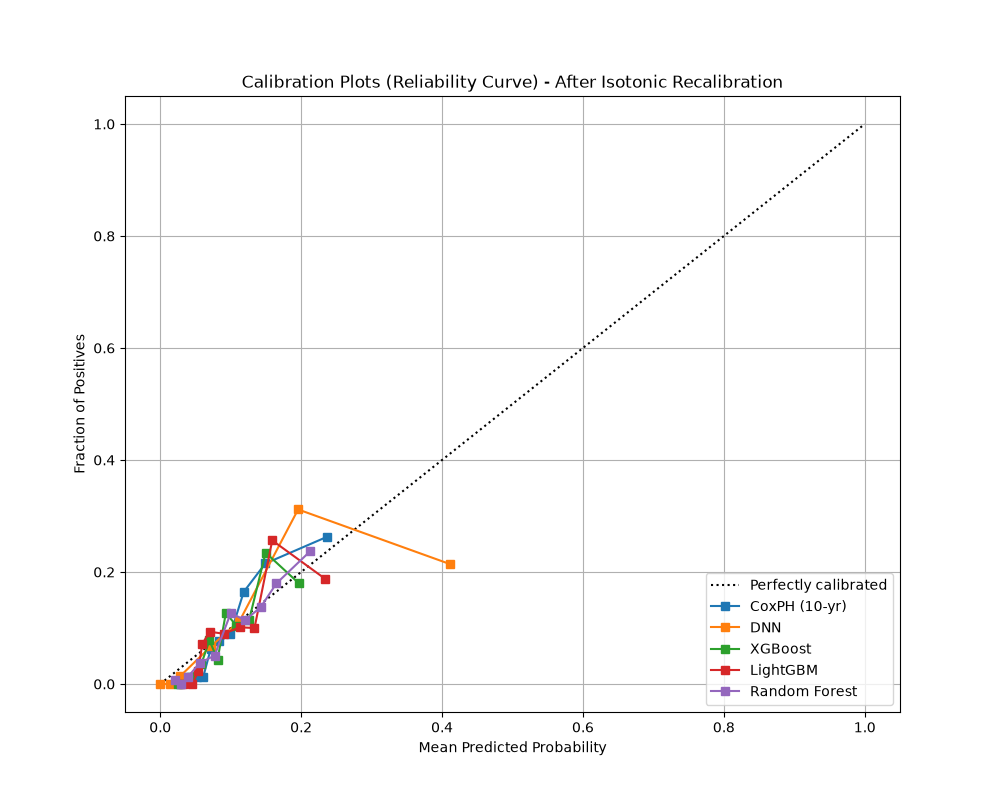

# Phase 2: Model Comparison Summary

This document summarizes the final baseline validation for the cardiac risk prediction models. The purpose of these baselines is to establish a robust, reliable trajectory engine (CoxPH) alongside a differentiable surrogate (DNN) for Phase 4's counterfactual search.

## Final Evaluation Metrics

Models were evaluated on a stratified 20% hold-out test set from `PERIOD == 1`. To handle severe class imbalance (~9.6% event rate) and prevent test-set threshold leakage, probability thresholds for F1 and Accuracy were optimized exclusively on a separate 20% validation set, then applied blindly to the test set.

| Model | AUC-ROC | PR-AUC | Optimal F1 | Acc@Opt | Brier Score |
| :--- | :--- | :--- | :--- | :--- | :--- |
| **CoxPH (10-yr)** | 0.7951 | 0.2458 | 0.3216 | 0.8295 | 0.0759 |
| **DNN** | 0.7875 | 0.2077 | 0.3152 | 0.8409 | 0.0797 |
| **XGBoost** | 0.7284 | 0.1797 | 0.2749 | 0.8068 | 0.0789 |
| **LightGBM** | 0.7443 | 0.1838 | 0.1918 | 0.8510 | 0.0794 |
| **Random Forest** | 0.7607 | 0.2043 | 0.2724 | 0.7235 | 0.0775 |

*Note: DNN was structured as a lean `32 -> 16 -> 1` network with 0.5 Dropout and weight decay to prevent overfitting, using Early Stopping on the validation set.*

## Calibration Diagnostics

Because tree models and the DNN were trained using explicit class weights (`scale_pos_weight`, `pos_weight`, etc.) to improve ranking (AUC), their raw predicted probabilities were artificially inflated. To correct this and ensure clinical trust, they were post-hoc recalibrated using **Isotonic Regression**. 

Cox natively models the baseline hazard and produces well-calibrated survival probabilities without intervention.

### Key Takeaways for Thesis
1. **Cox is the standard for a reason**: The interpretable clinical standard (CoxPH) achieved the highest AUC (0.795) and the best calibration (Brier 0.075) straight out of the box, validating its role as the primary risk trajectory engine for Phase 4.
2. **DNN as a Valid Surrogate**: The DNN performs extremely competitively (AUC 0.787, F1 0.315) and serves as an excellent differentiable surrogate for latent counterfactual optimization.
3. **Rigorous Handling of Imbalance**: Class weighting followed by Isotonic Recalibration successfully decoupled the ranking objective from the probability-communication objective, a critical requirement for a trustworthy clinician-facing dashboard.

Models have been serialized to `models/` and are ready for Phase 3 (Autoencoder).
